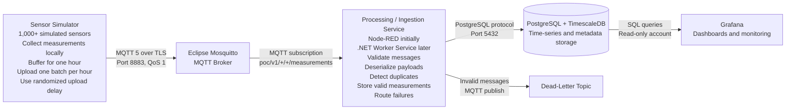
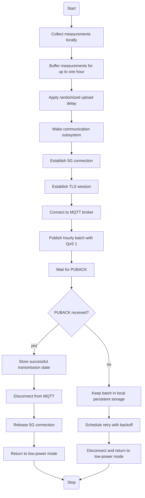
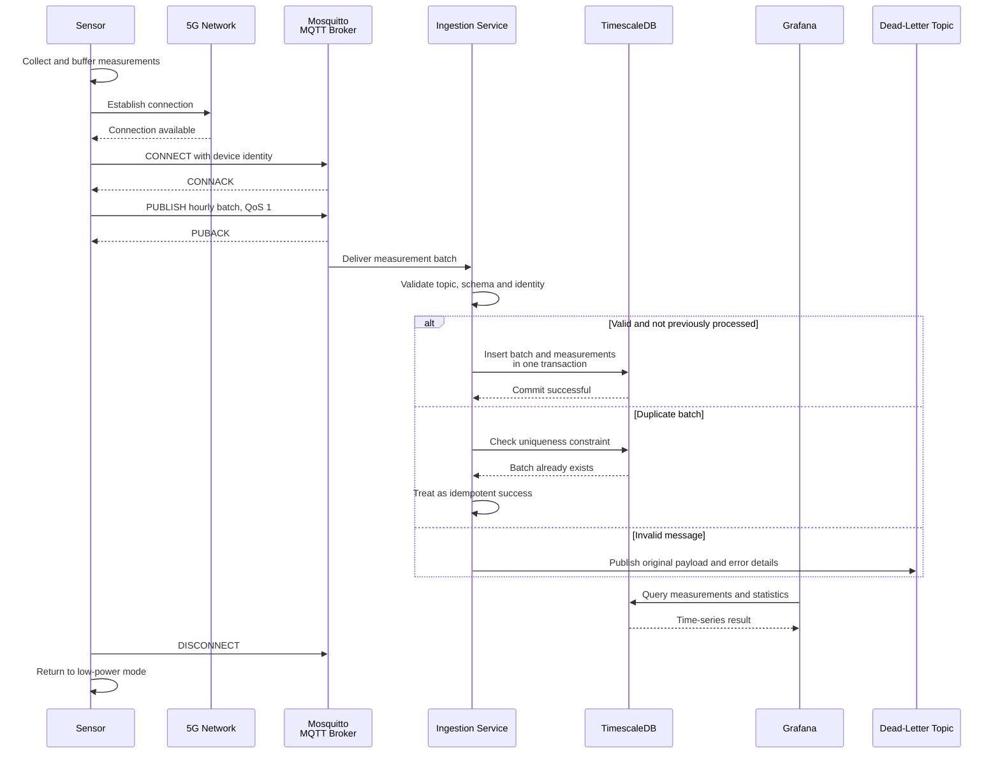

# Proof of Concept for the System Architecture

## 1. Purpose and Scenario

This proof of concept evaluates an IoT architecture in which more than 1,000 battery-powered sensors are distributed across a defined area.

Each sensor:

- collects measurement data locally;
- buffers the measurements for up to one hour;
- establishes a 5G connection;
- sends one batch of measurements to an MQTT broker;
- waits for confirmation; and
- returns to a low-power state.

The proof of concept should validate the complete data path from simulated sensors through MQTT ingestion and processing to time-series storage and visualization.

## 2. Recommended Proof-of-Concept Architecture



The sensors must not connect directly to the database. Only the processing service should possess database credentials.

## 3. Required Components

| Component | Recommended software | Purpose | PoC requirement |
|---|---|---|---|
| Container runtime | Docker Desktop or Docker Engine | Runs the complete environment locally | Required |
| Container orchestration | Docker Compose | Starts, connects and stops all services consistently | Required |
| Sensor simulator | C# console application or .NET Worker Service | Simulates more than 1,000 sensors and hourly batch uploads | Required |
| MQTT broker | Eclipse Mosquitto | Authenticates clients and routes MQTT messages | Required |
| Initial processing service | Node-RED | Subscribes to MQTT, validates messages and writes data to the database | Required for initial PoC |
| Production-style processing service | .NET Worker Service | Strongly typed, testable replacement for Node-RED | Later PoC phase |
| Time-series database | PostgreSQL with TimescaleDB | Stores measurements, batches and device metadata | Required |
| Visualization | Grafana | Displays measurements, device status and ingestion statistics | Recommended |
| MQTT test client | MQTTX or MQTT Explorer | Inspects topics and publishes test messages manually | Recommended |
| Database client | DBeaver, pgAdmin or JetBrains Rider database tools | Inspects tables and executes SQL | Recommended |
| Failure handling | MQTT dead-letter topic and database error table | Stores invalid or rejected messages | Recommended |
| Monitoring | Grafana and service metrics | Observes broker, processor and database health | Later PoC phase |

### Why these components?

- **Eclipse Mosquitto** is a lightweight, open-source MQTT broker suitable for an initial local environment.
- **Node-RED** allows the ingestion flow to be assembled and observed quickly before writing the production-style processor.
- **PostgreSQL with TimescaleDB** combines relational storage with time-series features.
- **Grafana** can query PostgreSQL/TimescaleDB and display measurement and operational dashboards.
- **Docker Compose** makes the environment repeatable and simplifies later deployment to another machine.

## 4. Interfaces Between Components

| From | To | Interface | Recommended configuration |
|---|---|---|---|
| Sensor simulator | MQTT broker | MQTT 5 over TCP/TLS | Port 8883 and QoS 1 |
| MQTT test client | MQTT broker | MQTT 5 over TCP or TLS | Port 1883 during early local development; port 8883 for secured testing |
| MQTT broker | Processing service | MQTT subscription | Topic wildcard and persistent session |
| Processing service | TimescaleDB | PostgreSQL protocol | Port 5432, parameterized SQL and database transactions |
| Grafana | TimescaleDB | PostgreSQL protocol | Read-only database account |
| Administrator | Node-RED | HTTP/HTTPS | Port 1880, restricted to local access |
| Administrator | Grafana | HTTP/HTTPS | Port 3000, restricted to local access |
| Processing service | Dead-letter flow | MQTT publish | Dedicated error topic |
| Monitoring tools | Services | Health and metrics endpoints | Add after the basic data flow works |

During the first local setup, unencrypted MQTT on port `1883` can be used to establish the data flow. Before realistic device testing, enable TLS and use port `8883`.

## 5. MQTT Topic Design

Define the topic hierarchy before implementing the devices.

```text
poc/v1/{areaId}/{deviceId}/measurements
poc/v1/{areaId}/{deviceId}/status
poc/v1/{areaId}/{deviceId}/events
poc/v1/{areaId}/{deviceId}/commands
poc/v1/ingestion/dead-letter
```

Example topics:

```text
poc/v1/area-01/sensor-00471/measurements
poc/v1/area-01/sensor-00471/status
```

The processing service subscribes with this wildcard:

```text
poc/v1/+/+/measurements
```

For stronger tenant or site isolation, extend the hierarchy:

```text
iot/v1/{customerId}/{siteId}/{areaId}/{deviceId}/measurements
```

Measurement values and timestamps should not be placed in topic names. They belong in the message payload.

## 6. Message Format

Each sensor should send one batch containing multiple samples.

```json
{
  "schemaVersion": 1,
  "messageId": "64ac0096-5aa0-4fe0-839e-bbf49cfeba93",
  "batchId": "sensor-00471-20261031T090000Z",
  "deviceId": "sensor-00471",
  "areaId": "area-01",
  "sentAt": "2026-10-31T09:00:08Z",
  "sequenceNumber": 741,
  "samples": [
    {
      "recordedAt": "2026-10-31T08:00:00Z",
      "temperature": 18.7,
      "humidity": 63.1,
      "batteryVoltage": 3.62
    },
    {
      "recordedAt": "2026-10-31T08:05:00Z",
      "temperature": 18.8,
      "humidity": 62.9,
      "batteryVoltage": 3.62
    }
  ]
}
```

### Important fields

- `schemaVersion` permits future payload changes.
- `messageId` uniquely identifies the application message.
- `batchId` uniquely identifies the hourly sensor batch.
- `sequenceNumber` helps detect missing or out-of-order uploads.
- `recordedAt` identifies when the sensor measured the value.
- `sentAt` identifies when the sensor transmitted the batch.
- `deviceId` should match the authenticated identity and MQTT topic.
- `samples` contains the measurements buffered on the sensor.

JSON is appropriate for the proof of concept because it is easy to inspect. If payload size later becomes critical, evaluate CBOR, MessagePack or Protocol Buffers.

## 7. MQTT Configuration

### 7.1 Quality of Service

Use **QoS 1** for measurement batches.

QoS 1 provides at-least-once delivery. Duplicate delivery is therefore possible, so the processing service and database must implement idempotency.

Possible uniqueness rules include:

```text
UNIQUE(device_id, recorded_at, measurement_type)
```

or:

```text
UNIQUE(batch_id, sample_index)
```

QoS 2 is not recommended for the initial proof of concept because it requires additional protocol exchanges and does not eliminate the need for database-level duplicate protection.

### 7.2 Retained Messages

- Measurement batches: `retain = false`
- Current device status: `retain = true`
- Commands: define according to the command semantics

Measurement batches should generally not be retained because a newly connected processor should not interpret an old retained measurement as a new upload.

### 7.3 Persistent Processing Session

Use a stable MQTT client ID and a persistent session for the processing service. The broker can then preserve subscribed QoS messages during a temporary processor outage, subject to the configured session expiry and storage limits.

### 7.4 Sensor Connection Lifecycle



The sensor should not remain connected for the entire hour solely to maintain an MQTT session.

## 8. Database Model

Use relational tables for device metadata and batch tracking, and a TimescaleDB hypertable for measurements.

### 8.1 `devices`

```text
device_id
area_id
description
firmware_version
registered_at
last_seen_at
status
```

### 8.2 `measurement_batches`

```text
batch_id
message_id
device_id
sequence_number
sent_at
received_at
sample_count
processing_status
payload_hash
```

### 8.3 `measurements`

```text
recorded_at
device_id
measurement_type
value
unit
quality_code
batch_id
```

### 8.4 `ingestion_errors`

```text
error_id
received_at
mqtt_topic
message_id
error_code
error_description
original_payload
```

### Storage-model decision

A flexible row-per-value model looks like this:

```text
sensor-00471 | 2026-10-31 08:00:00 | temperature | 18.7 | degC
sensor-00471 | 2026-10-31 08:00:00 | humidity    | 63.1 | percent
```

If all sensors always produce the same fields, a wide table is simpler and often more efficient:

```text
device_id
recorded_at
temperature
humidity
battery_voltage
quality_code
batch_id
```

For this proof of concept, use the **wide-table model** unless devices produce substantially different measurement types.

## 9. Capacity and Load Estimate

Assumptions:

- 1,000 sensors;
- one measurement every five minutes;
- 12 samples per hour per sensor;
- one hourly batch per sensor.

Resulting measurement volume:

```text
1,000 sensors x 12 samples = 12,000 samples/hour
12,000 x 24 = 288,000 samples/day
Approximately 105 million samples/year
```

The MQTT broker receives approximately:

```text
1,000 batch messages/hour
```

The average message rate is small, but an hourly synchronization point could create a burst of approximately 1,000 simultaneous connections and uploads.

Use a randomized transmission delay, for example:

```text
Scheduled upload time + random delay from 0 to 10 minutes
```

Example distribution:

```text
Sensor 0001 uploads at 10:00:13
Sensor 0002 uploads at 10:04:51
Sensor 0003 uploads at 10:08:07
```

The original measurement timestamps must remain unchanged. Only the transmission time is distributed.

## 10. Local Docker Environment

Recommended directory structure:

```text
iot-poc/
├── compose.yaml
├── .env
├── mosquitto/
│   ├── config/
│   │   ├── mosquitto.conf
│   │   ├── passwd
│   │   └── acl
│   ├── certs/
│   ├── data/
│   └── log/
├── database/
│   └── init/
│       ├── 001-create-schema.sql
│       └── 002-create-hypertable.sql
├── node-red/
│   └── data/
├── grafana/
│   └── provisioning/
├── simulator/
│   └── SensorSimulator/
└── processor/
    └── MeasurementIngestion.Worker/
```

Run the containers on an internal Docker network:

```text
iot-poc-network
```

Services communicate internally by container name:

```text
mosquitto:1883
timescaledb:5432
grafana:3000
node-red:1880
```

Expose only the necessary ports to the development machine:

```text
1883  MQTT development access
8883  MQTT over TLS
1880  Node-RED editor
3000  Grafana
5432  Optional database-client access
```

## 11. Implementation Plan

### Phase 1: Build the basic data path

1. Install Docker Desktop or Docker Engine with Docker Compose.
2. Create the Docker Compose project.
3. Start Mosquitto without TLS and restrict access to the local machine.
4. Start PostgreSQL with TimescaleDB.
5. Start Node-RED.
6. Create one simulated sensor.
7. Publish one JSON batch.
8. Subscribe to the message in Node-RED.
9. Validate the message and insert its samples into TimescaleDB.
10. Inspect the stored records using DBeaver, pgAdmin or Rider.

**Success criterion:** One simulated batch travels from the sensor through MQTT into the database.

### Phase 2: Add visualization

1. Start Grafana.
2. Add TimescaleDB as a PostgreSQL data source.
3. Create dashboards for:
   - temperature over time;
   - the latest reading per device;
   - battery voltage;
   - messages per hour;
   - late or missing devices; and
   - failed batches.

**Success criterion:** Measurements are visible shortly after MQTT publication.

### Phase 3: Simulate the sensor fleet

1. Expand the simulator from one device to 10 devices.
2. Increase to 100 devices.
3. Increase to 1,000 devices.
4. Give every device a unique MQTT client ID.
5. Generate measurements locally.
6. Buffer one hour of measurements.
7. Add randomized upload delay.
8. Simulate communication failures and retransmissions.
9. Measure broker, processor and database behavior.

**Success criterion:** All expected samples are stored exactly once despite QoS 1 retransmissions.

### Phase 4: Add security

1. Generate a local certificate authority.
2. Create a broker certificate.
3. Enable TLS on port 8883.
4. Disable anonymous access.
5. Create device identities and credentials.
6. Add topic-level access-control rules.
7. Give the processing service a separate subscriber identity.
8. Give Grafana a read-only database account.
9. Keep secrets and credentials out of source control.

Example authorization rule:

```text
sensor-00471:
    publish   -> poc/v1/area-01/sensor-00471/measurements
    publish   -> poc/v1/area-01/sensor-00471/status
    subscribe -> poc/v1/area-01/sensor-00471/commands
```

### Phase 5: Replace Node-RED with a C# processor

Implement a `.NET Worker Service` that:

1. connects to Mosquitto;
2. subscribes to the measurement topic;
3. deserializes the payload;
4. validates the schema;
5. verifies that the topic, payload and authenticated device IDs match;
6. validates the message and batch IDs;
7. writes the batch within a database transaction;
8. handles duplicate inserts safely;
9. publishes invalid messages to the dead-letter topic; and
10. exposes health and metrics endpoints.

Recommended solution structure:

```text
IoTMeasurementPlatform.sln
├── SensorSimulator
├── Ingestion.Worker
├── Core
├── Infrastructure.Mqtt
├── Infrastructure.Database
├── Contracts
├── Tests.Unit
└── Tests.Integration
```

## 12. End-to-End Data Flow



## 13. Important Architectural Decisions

### Do not connect sensors directly to the database

Only the processing service should access the database. Sensors communicate exclusively with the MQTT broker.

### Do not use MQTT as permanent measurement storage

The broker may buffer messages during temporary outages, but TimescaleDB is the system of record.

### Make processing idempotent

Duplicate delivery is normal with QoS 1. The processor and database must safely accept the same batch more than once without creating duplicate measurements.

### Store measurement time and reception time separately

```text
recorded_at = when the sensor measured the value
received_at = when the backend received the batch
```

The distinction is necessary because data may arrive approximately one hour after it was measured.

### Handle sensor clock synchronization

At minimum, include:

- UTC timestamps;
- sequence numbers;
- clock-synchronization status; and
- an optional clock-offset estimate.

### Define batch limits

Specify limits for:

- maximum MQTT payload size;
- maximum samples per batch;
- maximum accepted batch age;
- maximum future timestamp;
- retry count and backoff; and
- maximum locally buffered data.

If an hourly batch becomes too large, split it into ordered parts:

```json
{
  "batchId": "abc",
  "partNumber": 1,
  "partCount": 3
}
```

## 14. Recommended PoC Stack

The initial local stack should be:

```text
Docker Compose
├── Eclipse Mosquitto
├── Node-RED
├── PostgreSQL + TimescaleDB
├── Grafana
└── C# sensor simulator
```

After the message contract and data flow are proven, replace Node-RED with a tested `.NET Worker Service`.

This approach provides a fast initial result while preserving a path toward a strongly typed, maintainable and testable production architecture.
