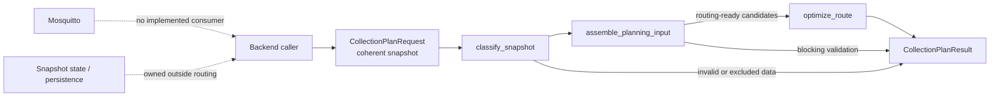

# Routing Component Stage 5

## Inspection Findings

The repository currently contains a self-contained Python routing package in
`code/routing/`. Stages 1 and 2 provide immutable normalized models,
structural validation, and deterministic fill classification. Stage 3 builds
solver-independent planning inputs. Stage 4 optimizes one mandatory-visit
truck round trip with OR-Tools.

Docker currently runs only Mosquitto. There is no backend, sensor consumer,
database, snapshot accumulator, routing worker, or result consumer in the
repository. The MQTT documents describe a future ingestion proof of concept;
they do not define an implemented fill-level message contract or planning
trigger. Stage 5 therefore does not add MQTT integration or infer behavior
from the broker's presence.

The current Compose file parses successfully, but its Mosquitto mount names
do not match the checked-in paths and should be addressed by a separate
infrastructure change. Stage 5 does not modify that configuration.

## Implemented Scope

The application layer is implemented in
`code/routing/src/smart_bin_routing/orchestration.py`.



Solid arrows are implemented application calls. Dashed arrows are deferred
or external responsibilities. No MQTT connection is opened by importing or
calling the routing package.

## Public API

```python
from smart_bin_routing import CollectionPlanRequest, plan_collection

request = CollectionPlanRequest(
    snapshot=snapshot,
    config=config,
    planning_time=planning_time,
    travel_costs=travel_costs,
    solver_config=solver_config,  # optional
)
result = plan_collection(request)
```

The backend supplies:

- One coherent `PlanningSnapshot` containing bin metadata, observations, and
  explicit collection demands.
- A timezone-aware `planning_time`.
- `PlanningConfig`, including thresholds, freshness, depot, capacity, and
  demand unit.
- A validated `TravelCostMatrix` with explicit node ordering and units.
- Optional `SolverConfig`.

The caller owns snapshot assembly, persistence, scheduling, and any transport
message parsing. Fill fraction is never converted into collection demand.
Demand and capacity must already use the configured unit. Missing travel
costs remain unavailable; they are not replaced with zero.

## Result Contract

`CollectionPlanResult` contains:

- `status`: the application-level outcome.
- `bins`: one assessment per structurally known bin, including classification,
  routing readiness, route inclusion, and diagnostics.
- `solver_result`: the existing `PlanningResult` when optimization ran.
- `diagnostics`: preprocessing and solver diagnostics.
- `route_nodes` and `stops` convenience properties.

`CollectionPlanStatus` values are:

- `invalid_request`: structural validation or required planning data failed.
- `no_actionable_bins`: the valid snapshot contained no bins.
- `no_routing_ready_candidates`: bins were classified, but none had all
  required routing inputs.
- `feasible`: a bounded feasible route passed Stage 4 validation.
- `infeasible`: mandatory capacity or directed-connectivity constraints make
  the problem infeasible.
- `search_exhausted`: the solver returned without a route before the limit.
- `time_limit`: the search limit ended without a route.
- `solver_error`: the existing solver adapter reported an unexpected failure.
- `dependency_failure`: reserved for an established external dependency
  boundary; no such provider is currently connected by this repository.

The existing Stage 4 semantics are unchanged: one vehicle, one trip, one
depot, mandatory admitted candidates, explicit capacity units, directed
travel costs, and no optional-visit penalties or split collection. A solver
timeout is not reported as infeasibility. No-work results do not fabricate a
route; `route_nodes` is empty when optimization is skipped.

## Validation and Exclusions

The workflow is deliberately ordered:

```text
request validation
  -> structural snapshot validation
  -> contextual observation validation and fill classification
  -> planning-input assembly
  -> optimizer, only if candidates are routing-ready
```

Classification remains separate from routing readiness. For example, a bin
with a missing observation remains visible as `unknown`, with
`missing_observation` and `unknown_classification_sensor_check` diagnostics,
but is not passed to the optimizer. Missing demand and missing travel nodes
are also visible exclusions. A valid classified bin with explicit demand is a
candidate even if its fill classification is green; the routing package does
not invent a policy that selects bins from fill color.

## Backend and Infrastructure Boundaries

The backend or an upstream ingestion service must own:

- MQTT connection and subscription lifecycle.
- Topic and payload validation.
- Duplicate and redelivery semantics.
- Observation state and coherent snapshot construction.
- Metadata and demand sourcing.
- Planning scheduling and result delivery.
- Database transactions and persistence.

The routing package owns only normalized application data, deterministic
validation/classification, planning-input preparation, and optimization. It
does not import an MQTT client, connect to Mosquitto, publish messages, read
Docker configuration, access a database, or write files.

The repository does not currently define when optimization should run or how
individual MQTT observations become a complete snapshot. Those decisions are
deferred rather than guessed.

## Example and Checks

The offline example uses the established modeled `kva-basel` depot and fully
synthetic observations, demands, and travel costs. The travel-cost unit is
explicitly labelled `synthetic-km` and is not a real Basel estimate.

```text
cd code/routing
uv run python examples/stage5_collection_plan.py
```

The package checks are:

```text
cd code/routing
uv run pytest
uv run ruff check .
uv run ruff format --check .
```

Tests use fakes for orchestration branches and retain the existing genuine
OR-Tools route tests. They do not require Docker, Mosquitto, a database,
network access, or credentials.

## Deferred Work

- Fill-level MQTT payload and topic contract.
- Snapshot accumulation, completeness, persistence, and deduplication.
- Backend service and transport adapter.
- Planning trigger and result delivery contract.
- Real demand estimation and travel-cost provider.
- Sensor-quality semantics and historical fault detection.
- Multiple vehicles, time windows, route geometry, and split collection.
- Correction of unrelated Compose/Mosquitto path inconsistencies.
