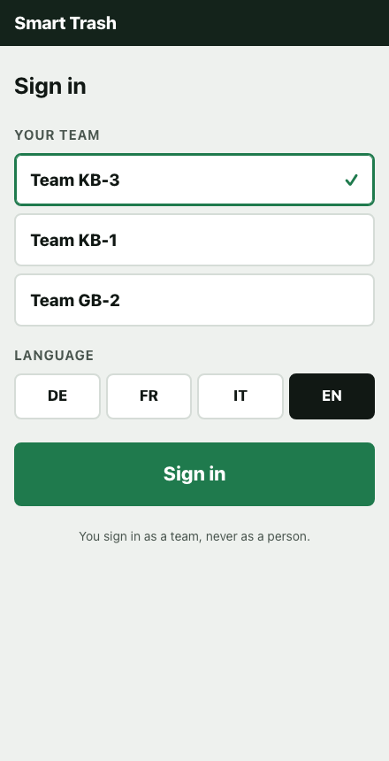
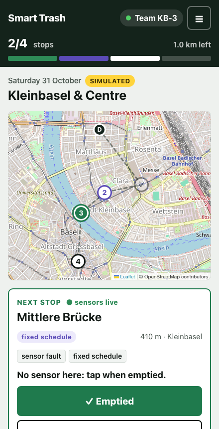
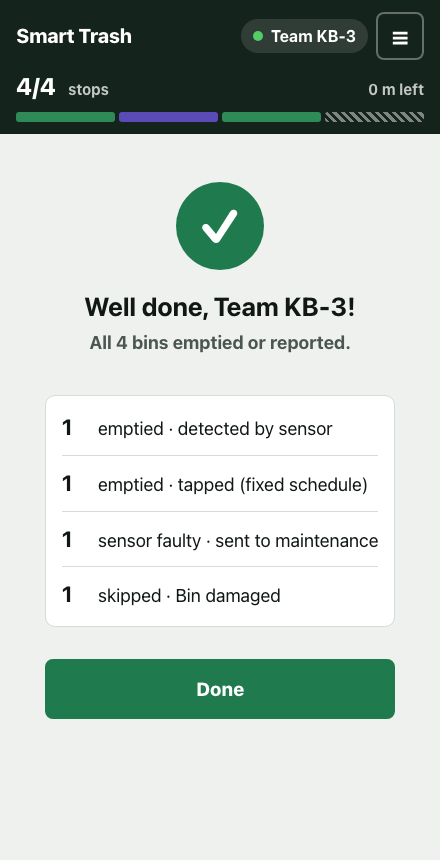
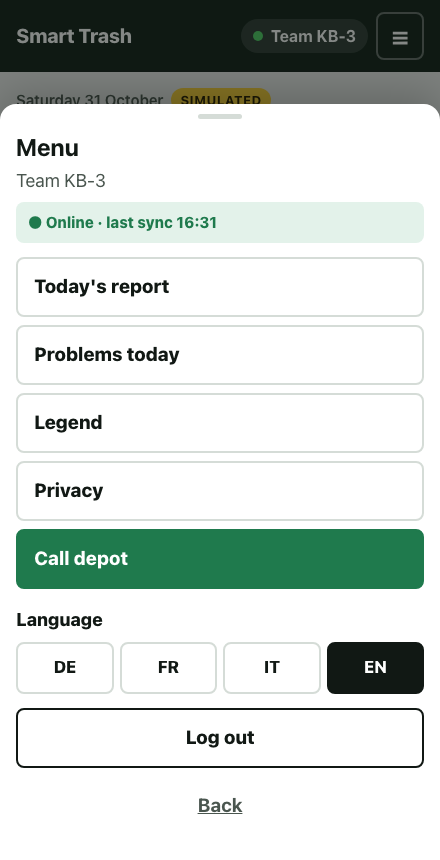
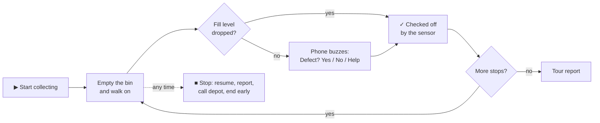

# Smart Trash: Empty When Full

**Predict · Detect · Optimize.** Fill-level sensors and software that tell a city which public bins are full, which sensors are faulty, and which bins to empty today.

BaselHack 2026 · pilot city: Lucerne (about 960 public bins)

<p>
  
  
  
  
</p>

## The problem

Swiss cities empty public bins on a **fixed schedule**. Half-empty bins get emptied, while bins at lakesides, parks and events overflow on hot weekends. Lucerne spends around 16,100 working hours a year emptying its bins.

Sensors alone don't solve this. False readings made Bern stop two sensor pilots (2012, 2018).

## Our solution

1. **Predict** when each bin will be full (weekday, weather, events).
2. **Detect** faulty sensors. A bin whose fill level doesn't drop after a visit is flagged for maintenance.
3. **Optimize** which bins to empty today, and in which order.

Every decision is explained ("full ~13:00 · shopping Saturday"). A bin without valid data goes back on the fixed schedule, and the app shows this.

## What we built at the hack: the crew app

A mobile web app for the street-cleaning crew:

- **Start collecting**, then just work. The sensor sees the fill drop and checks off the stop with no tap.
- **Only problems need a tap**: not reachable, unsafe, bin damaged. Bins without a sensor need one tap.
- **Status bar** with one segment per bin, stops done and km left.
- **End-of-tour report** about the bins, never about the worker.
- **Menu**: today's report, problems, legend, privacy, call the depot, sync status, DE / FR / IT / EN.
- **Team sign-in**: no personal accounts, no GPS tracking, no ranking of workers.

## How a tour works

The phone stays in the pocket. The app only asks the crew when a sensor looks broken, or when the crew taps Stop.



## Design decisions

| Decision | Why |
|---|---|
| Zero taps on a normal stop | The crew works with gloves and both hands full; the app must add no work |
| The app asks only on a suspected fault | Turns a guess into ground truth that trains the fault detector, and answers "how do you know the sensor is broken?" |
| One defect list everywhere | The same three choices in the alert and after Stop: learned once |
| Yes / No / Help, auto-confirm after 6 s | Like a navigation alert: never blocks the crew when nobody answers |
| Undo after every report | Mistakes with gloves happen; nothing is final after one tap |
| Team sign-in, reports per bin | No GPS tracking, no times per person, no ranking: the crew must not feel monitored |
| Bins without valid data show "fixed schedule" | The fallback is visible, never hidden |

## Try it

```bash
cd code/crew-app
python3 -m http.server 5050
```

Open <http://localhost:5050>, sign in, and tap **▶ Start collecting**. The demo tour has four bins, one for each case (sensor OK, sensor fault, no sensor, bin damaged), and ends with the report after about 20 seconds. The phone stays in the pocket: it only asks the crew when a sensor looks broken.

Details: [documentation/crew-app.md](documentation/crew-app.md)

## Honest data

- All fill levels, forecasts and sensor events in the demo are **SIMULATED**, and the app says so.
- Real open data for Basel is in `assets/geojson/` (litter reports and the street cleanliness index). It is not bin fill-level data.
- We compare only against the city's real fixed schedule.

## Repository

| Folder | Content |
|---|---|
| [`code/crew-app/`](code/crew-app/) | Crew mobile web app (HTML, CSS, JS, Leaflet) |
| [`documentation/`](documentation/) | [Crew app](documentation/crew-app.md) · [User stories](documentation/user-stories.md) · [Architecture PoC](documentation/Proof_of_Concept_for_the_system_architecture.md) · [Tasks and roles](documentation/tasks.md) |
| [`assets/`](assets/) | Screenshots, open data (GeoJSON), photos |

Work is tracked on the [project board](https://github.com/orgs/Basel-Hackthon-Smart-Trash/projects/1).

## Team

| Name | Role |
|---|---|
| Abbas | Development, project lead |
| Rai | UI/UX |
| Andy | Data science |
| Dennis | Backend |
| Maria | Brand identity |

## License

[MIT](license.txt)
